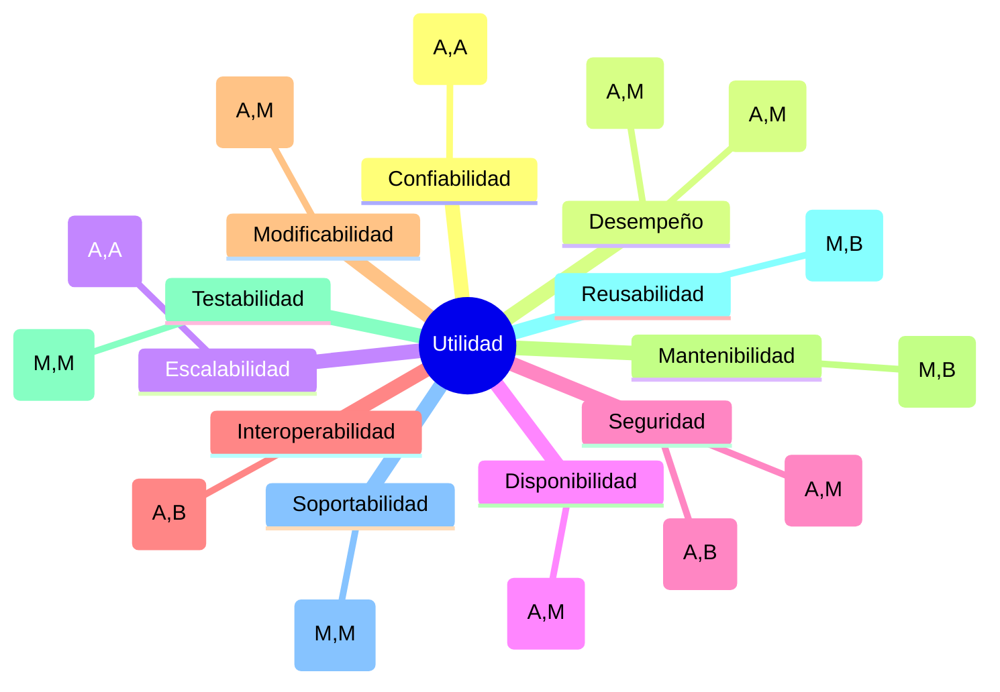

# 2. Atributos de calidad

## 2.1 Árbol de utilidad (ATAM)

Prioridad expresada como (importancia para el negocio, dificultad técnica): A = alta, M = media, B = baja.

## 2.2 Escenarios de atributos de calidad

Cada escenario indica las **tácticas** aplicadas y la **evidencia** en el código.

### QAS-R1 — Confiabilidad: exactitud ante entrega duplicada y datos revisados
| Parte | Valor |
|---|---|
| Fuente | SQS (entrega al-menos-una-vez), proveedores que revisan datos, clientes que reintentan |
| Estímulo | El mismo registro llega N veces, o llega una versión corregida del mismo día |
| Artefacto | Ledger de consumo (hechos + agregados) |
| Entorno | Operación normal y bajo estrés, con colectores concurrentes |
| Respuesta | El agregado refleja exactamente la última versión de cada hecho |
| Medida | Diferencia entre costo agregado y costo real = **0,00 USD** con 15 % de duplicados |

**Tácticas:** clave natural determinista, *upsert* con deltas, transacción atómica y control de concurrencia
optimista (ADR-0004). **Evidencia:** `domain/ledger.py`, `adapters/dynamodb.py`, prueba de propiedades
`test_aggregates_converge_to_latest_version` y verificación de consistencia de `scripts/loadgen.py`.

### QAS-P1 — Desempeño: ingesta *push*
| Parte | Valor |
|---|---|
| Fuente | Sistema externo autenticado (M2M) |
| Estímulo | `POST /v1/usage/records` con 25 registros a 50 req/s sostenidas |
| Artefacto | API Gateway + Lambda `api` |
| Entorno | Operación normal, contenedores *warm* |
| Respuesta | 202 Accepted; el procesamiento continúa de forma asíncrona |
| Medida | p95 < 500 ms, p99 < 1 s en la API; dato visible en el dashboard en < 60 s (p95) |

**Tácticas:** procesamiento asíncrono (cola), validación temprana, Lambda con 1024 MB (más CPU).
**Evidencia:** `handlers/api.py::ingest_records`, umbrales en `tests/load/k6_ingest.js`.

### QAS-P2 — Desempeño: consulta del dashboard
| Parte | Valor |
|---|---|
| Fuente | Usuario del dashboard |
| Estímulo | Consulta de resumen de 30 días |
| Artefacto | Modelo de lectura (agregados diarios) |
| Entorno | 50 personas, 4 proveedores, 10 modelos |
| Respuesta | KPIs, series y rankings |
| Medida | p95 < 800 ms |

**Tácticas:** CQRS con agregados precalculados, particionamiento mensual (≤ 4 particiones por cada 90 días).
**Evidencia:** `services/dashboard.py`, `adapters/keys.py`.

### QAS-S1 — Escalabilidad / elasticidad
| Parte | Valor |
|---|---|
| Fuente | Ráfaga de ingesta (cierre de mes, *backfill*) |
| Estímulo | La carga sube de 20 a 500 req/s en 10 s |
| Artefacto | Ruta de escritura completa |
| Entorno | Producción |
| Respuesta | El sistema absorbe la ráfaga; el *backlog* se drena sin pérdida |
| Medida | 0 mensajes perdidos; 0 en DLQ; *backlog* drenado en < 15 min |

**Tácticas:** colas como amortiguador (*queue-based load leveling*), consumidores en competencia, DynamoDB
*on-demand*, concurrencia máxima del consumidor para proteger el almacenamiento.
**Evidencia:** `infra/terraform/envs/dev/main.tf` (`scaling_config`), escenario `spike` de k6.

### QAS-A1 — Disponibilidad
| Parte | Valor |
|---|---|
| Fuente | Falla de un proveedor externo (5xx, 429, credencial vencida) o de una AZ |
| Estímulo | Un conector falla repetidamente |
| Artefacto | Colector |
| Entorno | Producción |
| Respuesta | Los demás conectores y el dashboard siguen operando; el mensaje fallido se reintenta y termina en DLQ con alarma |
| Medida | API ≥ 99,9 % mensual; aislamiento por mensaje (*partial batch response*) |

**Tácticas:** reintento con *backoff*, *bulkhead* por mensaje, DLQ, servicios regionales multi-AZ administrados.
**Evidencia:** `handlers/collector.py`, `test_collector_reports_partial_failures`, `modules/sqs_queue`.

### QAS-SE1 — Seguridad: aislamiento multi-tenant
| Parte | Valor |
|---|---|
| Fuente | Usuario autenticado malicioso |
| Estímulo | Intenta leer o escribir datos de otro tenant (cuerpo manipulado) |
| Artefacto | API |
| Entorno | Producción |
| Respuesta | Rechazo (400/403); no hay acceso cruzado |
| Medida | 0 rutas en las que el tenant provenga de una entrada del cliente |

**Tácticas:** tenant derivado del JWT, `extra="forbid"`, claves con prefijo `T#{tenant}`.
**Evidencia:** `handlers/api.py::current_caller`, `test_tenant_isolation`.

### QAS-SE2 — Seguridad: custodia de credenciales
Las llaves Admin viven en Secrets Manager (KMS). IAM limita el acceso a `secret:usagehub/*` solo para el
colector, y AWS se lee mediante AssumeRole con ExternalId. **Medida:** 0 secretos en código, variables de
entorno o logs (gitleaks en pre-commit).

### QAS-I1 — Interoperabilidad
| Parte | Valor |
|---|---|
| Fuente | Un sistema no soportado (LLM interno, SaaS, herramienta propia) |
| Estímulo | Necesita reportar consumo |
| Artefacto | API de ingesta |
| Respuesta | Integra con HTTP + OAuth2 estándar usando el contrato OpenAPI publicado |
| Medida | Integración sin cambios en UsageHub; contrato versionado (`/v1`) |

**Evidencia:** `docs/openapi.yaml`, modelo canónico `UsageRecord`.

### QAS-M1 — Modificabilidad
| Parte | Valor |
|---|---|
| Fuente | Desarrollador |
| Estímulo | Agregar un proveedor nuevo |
| Artefacto | Sistema |
| Entorno | Tiempo de desarrollo |
| Respuesta | Se agrega un módulo conector; el núcleo no cambia |
| Medida | 1 archivo nuevo + 1 línea de registro; 0 cambios en dominio, API o dashboard |

**Tácticas:** puertos y adaptadores, Strategy + Registry, modelo canónico (ADR-0002).

### QAS-MA1 — Mantenibilidad
`ruff` (más de 15 familias de reglas, incluido bandit) y `mypy --strict` se ejecutan en CI y bloquean el *merge*.
El tamaño de los módulos está acotado y el núcleo de dominio no depende de AWS. **Medida:** 0 errores estáticos.

### QAS-T1 — Testabilidad
Los puertos permiten probar el dominio con adaptadores en memoria y la infraestructura con moto.
**Medida:** cobertura de ramas ≥ 80 % (lograda: 94,7 %), suite completa en menos de 30 s y sin cuenta de AWS.

### QAS-RU1 — Reusabilidad
Hay módulos Terraform genéricos (`lambda_function`, `sqs_queue`, `static_site`, `cost_reader_role`) y
conectores independientes de la plataforma. **Medida:** cada módulo se instancia 1..N veces sin modificarlo
(`lambda_function` se instancia 4 veces).

### QAS-SU1 — Soportabilidad
| Parte | Valor |
|---|---|
| Fuente | Operador on-call |
| Estímulo | Alarma de DLQ o de latencia |
| Respuesta | Identifica la causa con trazas, logs estructurados y el runbook |
| Medida | MTTD < 5 min (alarmas); diagnóstico < 15 min |

**Tácticas:** logs JSON con `correlation_id`, X-Ray, métricas EMF de negocio (`RecordsWritten`,
`LedgerRetry*`, `QueueToLedgerLatency`), dashboard operativo y runbook.

## 2.3 Matriz atributo → táctica → componente

| Atributo | Tácticas | Componentes |
|---|---|---|
| Desempeño | Asincronía, CQRS, precálculo, más memoria = más CPU | api, DynamoDB (agregados) |
| Interoperabilidad | Modelo canónico, OpenAPI, OAuth2 estándar | api, connectors |
| Escalabilidad | Cola de nivelación, consumidores en competencia, *on-demand* | SQS, collector, DynamoDB |
| Confiabilidad | Idempotencia, transacciones, OCC, DLQ | ledger, adapters.dynamodb |
| Disponibilidad | Servicios multi-AZ administrados, aislamiento de fallas, reintentos | collector, SQS |
| Seguridad | JWT, mínimo privilegio, cifrado, ExternalId | Cognito, IAM, Secrets Manager |
| Mantenibilidad | Capas, tipado estricto, lint | todo `src/` |
| Modificabilidad | Hexagonal, Strategy/Registry | domain.ports, connectors |
| Testabilidad | Inyección de dependencias, dobles en memoria, moto | adapters.memory, tests |
| Reusabilidad | Módulos IaC parametrizados | infra/terraform/modules |
| Soportabilidad | Observabilidad, runbook, alarmas | Powertools, CloudWatch |
