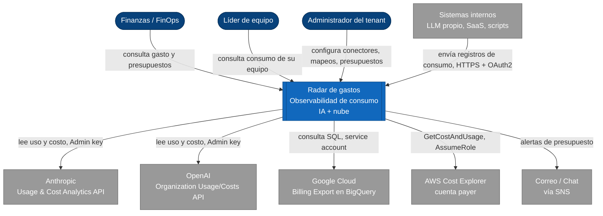
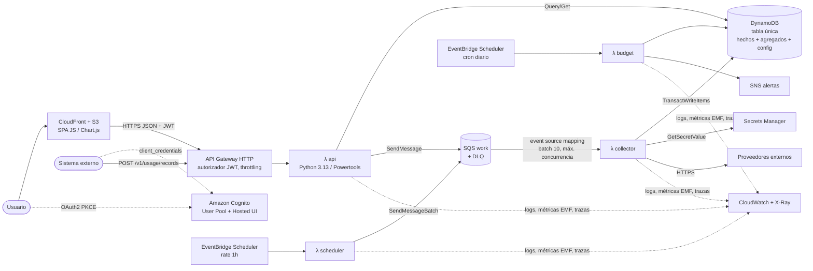
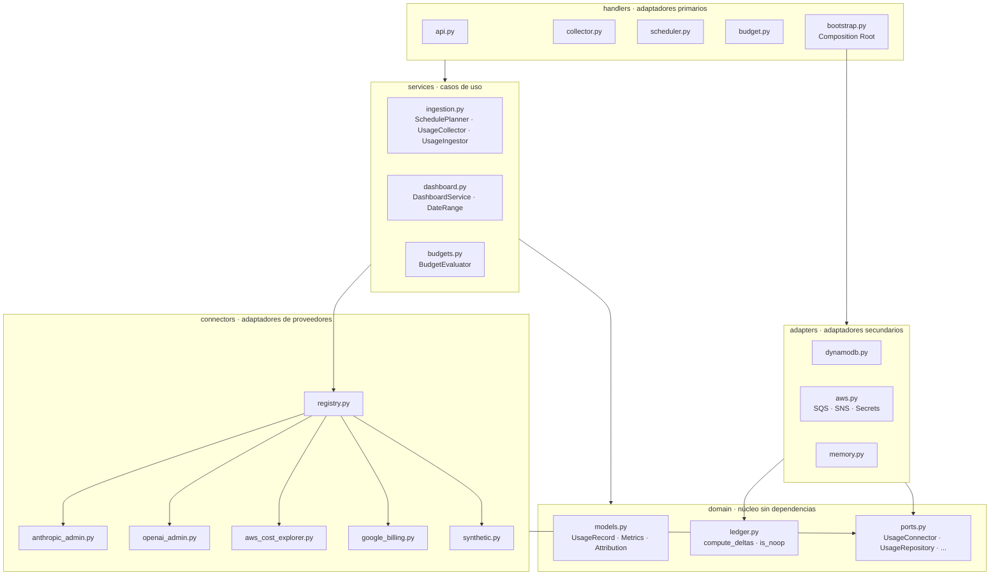
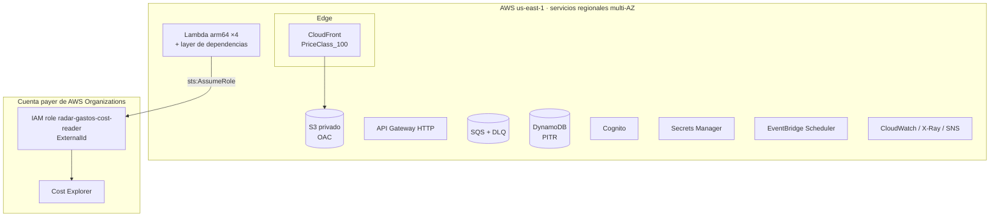
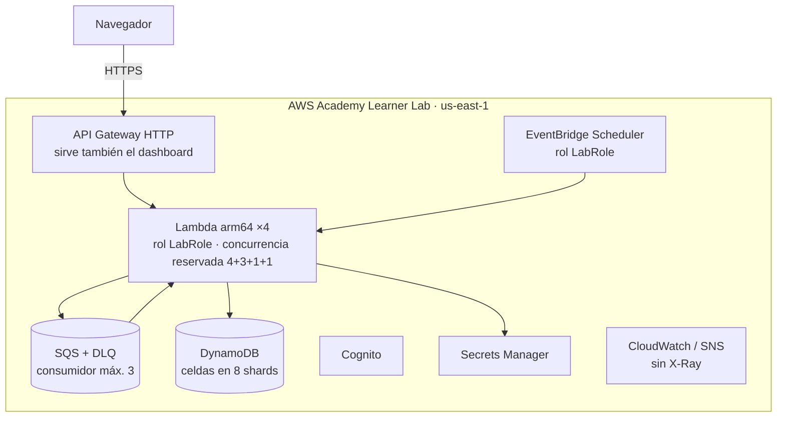
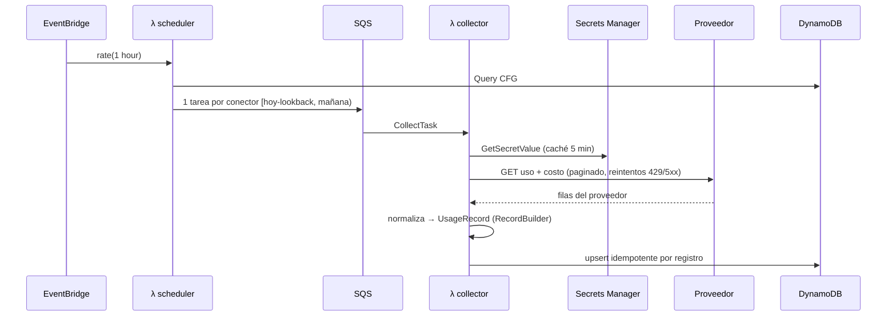

# 3. Vistas de arquitectura (modelo C4)

## 3.1 Nivel 1: contexto del sistema



## 3.2 Nivel 2: contenedores



| Contenedor | Tecnología | Responsabilidad | Escala |
|---|---|---|---|
| SPA | HTML/JS, Chart.js, CloudFront | Visualización, login PKCE | CDN |
| API | Lambda Python 3.13 arm64 | Consultas, ingesta *push*, gobierno | Concurrencia Lambda, throttling |
| Scheduler | Lambda | *Fan-out* de tareas por conector | 1 invocación/h |
| Collector | Lambda (consumidor SQS) | *Pull* a proveedores y escritura del ledger | Hasta `maximum_concurrency` |
| Budget | Lambda | Evaluación de presupuestos | 1 invocación/día |
| Cola | SQS estándar + DLQ | Amortiguar, reintentar, aislar fallas | Prácticamente ilimitada |
| Ledger | DynamoDB on-demand | Hechos, agregados, configuración | Automática |
| Identidad | Cognito | Usuarios, grupos, clientes M2M | Administrada |

## 3.3 Nivel 3: componentes (código Python)



**Regla de dependencias:** las flechas apuntan hacia el dominio. `domain` no importa nada de
`services`, `adapters`, `handlers` ni de bibliotecas de AWS.

## 3.4 Vista de despliegue



**Variante en AWS Academy Learner Lab (ADR-0017).** La cuenta del laboratorio no permite crear roles IAM ni usar
CloudFront o X-Ray, y admite como máximo 10 ejecuciones concurrentes de Lambda:



## 3.5 Vista dinámica: ingesta *push* con duplicado

```mermaid
sequenceDiagram
  autonumber
  participant X as Sistema externo
  participant G as API Gateway
  participant A as λ api
  participant Q as SQS
  participant C as λ collector
  participant D as DynamoDB
  X->>G: POST /v1/usage/records (JWT)
  G->>G: valida firma/aud/exp
  G->>A: evento v2 + claims
  A->>A: tenant ← claim; valida esquema
  A->>Q: SendMessageBatch (≤200 registros/msg)
  A-->>X: 202 {accepted, record_ids}
  Q->>C: lote (≤10 mensajes)
  loop por registro
    C->>D: GetItem(hecho, ConsistentRead)
    alt contenido idéntico
      C->>C: UNCHANGED (sin escritura)
    else nuevo o revisado
      C->>D: TransactWriteItems[Put hecho (version=v) + ADD Δ en 3 agregados]
      alt ConditionalCheckFailed / TransactionConflict
        C->>C: backoff con jitter y reintento
      end
    end
  end
  C-->>Q: batchItemFailures (solo los fallidos)
  Note over Q,C: Si el mensaje se entrega de nuevo, todos los registros salen UNCHANGED.
```

## 3.6 Vista dinámica: recolección *pull* horaria


