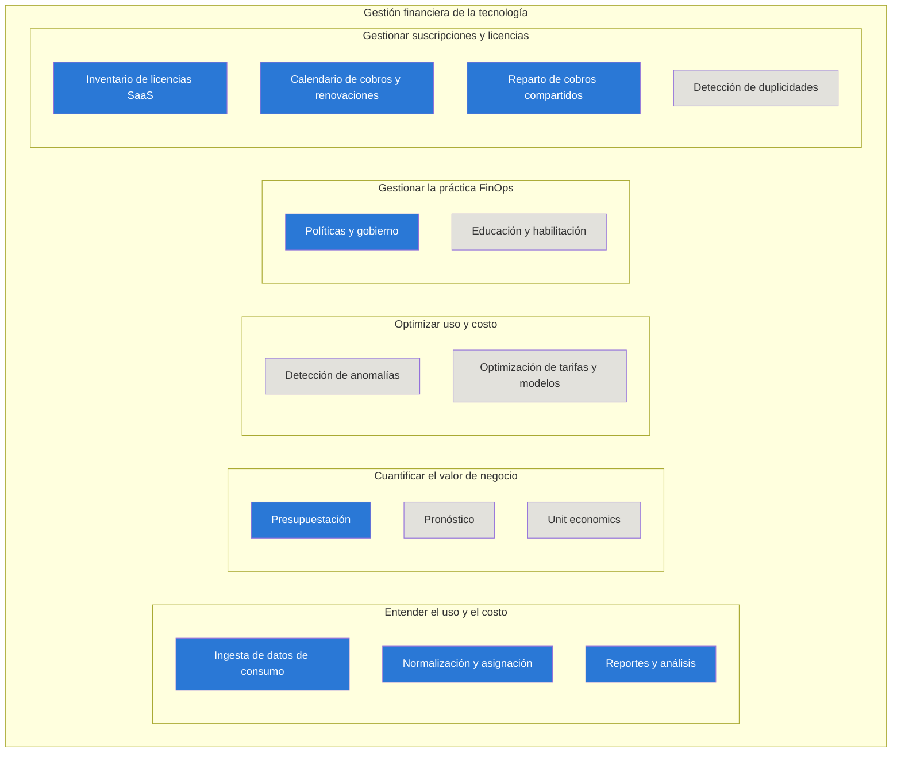
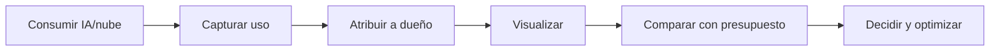
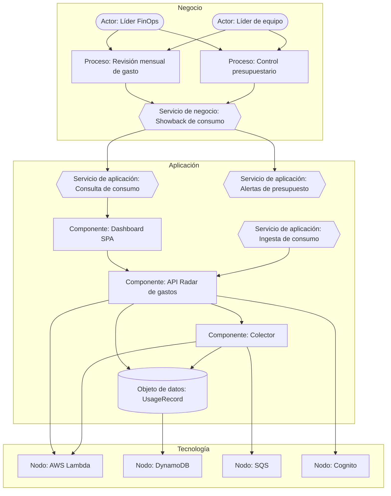
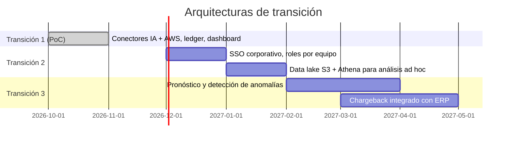

# 5. Arquitectura empresarial

El análisis sigue el **TOGAF Standard, 10.ª edición (ADM)** y representa las capas con la notación conceptual de
**ArchiMate 3.2** (negocio, aplicación, tecnología), expresada en Mermaid para versionarla como código.

## 5.1 Recorrido del ADM aplicado

| Fase ADM | Salida en este proyecto |
|---|---|
| Preliminar | Principios de arquitectura (5.2), alcance FinOps, repositorio de arquitectura como código |
| A. Visión | Visión, interesados y *drivers* ([01](01-contexto-negocio.md)) |
| B. Arquitectura de negocio | Mapa de capacidades, cadena de valor, actores y roles (5.3, 5.4) |
| C. Sistemas de información | Modelo canónico de datos ([07](07-modelo-datos.md)); componentes de aplicación (5.5) |
| D. Tecnología | Plataforma serverless en AWS ([C4 despliegue](03-vistas-c4.md#34-vista-de-despliegue)) |
| E. Oportunidades y soluciones | *Gap analysis* (5.6) y paquetes de trabajo |
| F. Planificación de la migración | *Roadmap* de transición (5.7) |
| G. Gobierno de la implementación | Revisiones de ADR, CI como control de conformidad ([06](06-gobierno-ti.md)) |
| H. Gestión del cambio | ADR nuevas que reemplazan a las anteriores; métricas de gobierno |
| Gestión de requisitos | Escenarios de calidad trazables a tácticas y pruebas ([02](02-atributos-calidad.md)) |

## 5.2 Principios de arquitectura

| # | Principio | Fundamento | Implicaciones |
|---|---|---|---|
| P1 | **Una sola verdad del consumo** | Las decisiones financieras requieren cifras únicas | Ledger canónico; ningún informe lee directamente de los proveedores |
| P2 | **Todo gasto tiene dueño** | La atribución habilita el *showback* | Mapeo obligatorio; KPI de % sin asignar |
| P3 | **Integración por contrato** | Proveedores cambiantes | Modelo canónico + API versionada + adaptadores |
| P4 | **Seguridad por diseño y mínimo privilegio** | Llaves Admin con alto impacto | Solo lectura, Secrets Manager, IAM por función |
| P5 | **Administrado antes que construido** | Equipo pequeño, BD5 | Serverless; cero servidores propios |
| P6 | **Infraestructura y arquitectura como código** | Trazabilidad y auditoría | Terraform, ADR y diagramas versionados |

## 5.3 Mapa de capacidades de negocio (FinOps)

Leyenda: en azul, las capacidades cubiertas por el PoC; en gris, la evolución futura. Los dominios C1 a C4
corresponden a los del FinOps Framework de la FinOps Foundation. C5 aplica esas capacidades a los *Scopes* de SaaS y
licencias que el marco incorporó en 2025 (*Cloud+*) y, en el espacio Personal, al gasto de un hogar.

## 5.4 Cadena de valor: "del consumo a la decisión"

## 5.5 Vista de capas (estilo ArchiMate)

## 5.6 *Gap analysis* (línea base → objetivo)

| Dimensión | Línea base (AS-IS) | Objetivo (TO-BE) | Brecha / paquete de trabajo |
|---|---|---|---|
| Datos | Consolas separadas, exportes CSV manuales | Ledger canónico consolidado | WP1: conectores + ledger |
| Atribución | Llaves compartidas sin dueño | Mapeo principal → persona → equipo | WP2: modelo de gobierno + API de mapeos |
| Control | Factura mensual (reactivo) | Presupuestos con alertas al 50/80/100 % | WP3: evaluador de presupuestos |
| Seguridad | Llaves Admin en hojas de cálculo | Secrets Manager + rotación | WP4: custodia y rotación |
| Integración | Ninguna | API abierta para cualquier sistema | WP5: API de ingesta + OpenAPI |
| Operación | N/A | IaC + observabilidad | WP6: Terraform + CloudWatch |

## 5.7 *Roadmap* de transición

