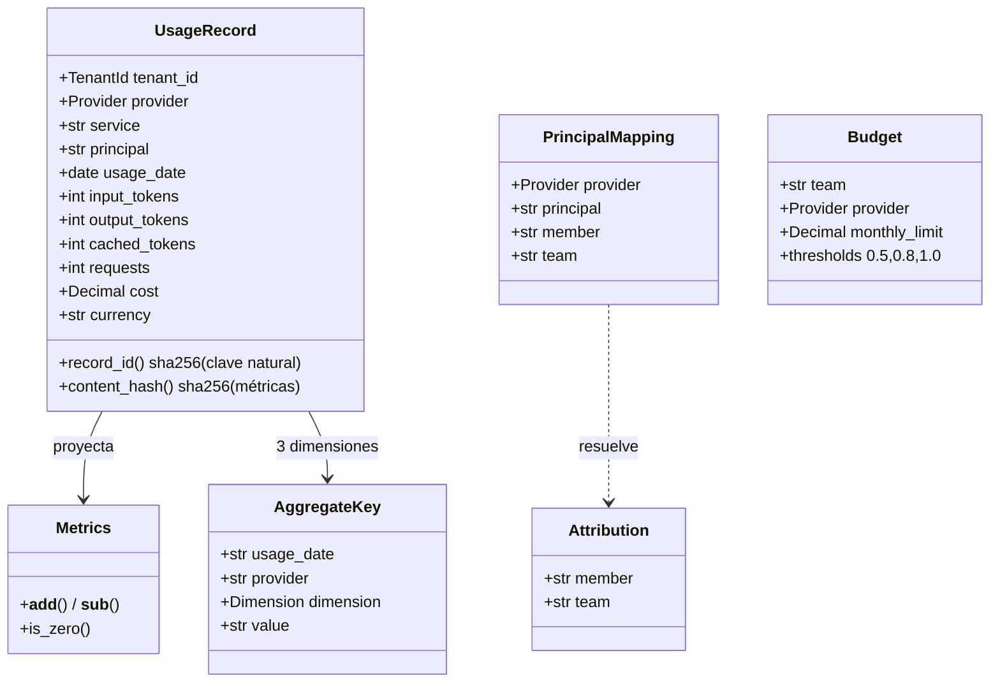

# 7. Modelo de datos

## 7.1 Modelo canónico

**Invariantes:** las métricas son ≥ 0 y al menos una es distinta de cero; el costo usa `Decimal` (nunca `float`)
con 6 decimales; `tenant_id` cumple `^[a-z0-9][a-z0-9-]{1,62}$`.

## 7.2 Mapeo desde cada proveedor

| Canónico | Anthropic (analytics) | OpenAI | AWS Cost Explorer | Google Billing |
|---|---|---|---|---|
| `service` | `group.model` | `model` / `line_item` | `SERVICE` | `service.description` |
| `principal` | `actor` → `user:…`, `service_account:…`, `api_key:…` | `user:…` / `api_key:…` / `project:…` | `tag:<owner>` / `untagged` | `labels.owner` / `project:…` |
| `input_tokens` | `uncached_input_tokens` + escritura de caché | `input_tokens` − `input_cached_tokens` | — | — |
| `cached_tokens` | `cache_read_input_tokens` | `input_cached_tokens` | — | — |
| `output_tokens` | `output_tokens` | `output_tokens` | — | — |
| `requests` | `requests` | `num_model_requests` | — | — |
| `cost` | `cost.amount` / 100 (centavos) | `amount.value` | `UnblendedCost.Amount` | `cost + créditos` |

## 7.3 Diseño de tabla única (DynamoDB)

| Entidad | PK | SK | Atributos |
|---|---|---|---|
| Hecho | `T#{tenant}#F#{yyyy-mm}` | `{yyyy-mm-dd}#{record_id}` | métricas, `member`, `team`, `content_hash`, `version` |
| Agregado | `T#{tenant}#A#{dim}#{yyyy-mm}` | `{yyyy-mm-dd}#{provider}#{valor}` | métricas (contadores `ADD`) |
| Mapeo | `T#{tenant}#MAP` | `{provider}#{principal}` | `member`, `team` |
| Conector | `CFG#CONNECTOR` | `{tenant}#{connector_id}` | `config` (sin secretos) |
| Presupuesto | `T#{tenant}#BUDGET` | `{team}#{provider|*}` | `budget` |
| Alerta enviada | `T#{tenant}#ALERT` | `{yyyy-mm}#{team}#{provider}#{umbral}` | — (marcador idempotente) |
| Gasto recurrente | `O#{dueño}#RECUR` (dueño = `user:{sub}` o `tenant:{id}`) | `{expense_id}` | servicio, categoría, monto, moneda, ciclo, fecha de cobro, usuarios, personas (`member_ids`) |
| Persona (personal) | `O#user:{sub}#PEOPLE` | `{profile_id}` | nombre, relación |

## 7.4 Patrones de acceso

| # | Patrón | Operación | Costo |
|---|---|---|---|
| AP1 | Leer un hecho por clave natural | `GetItem` (consistente) | 1 RCU |
| AP2 | Upsert de un hecho con deltas | `TransactWriteItems` (1 Put + ≤ 3 Update; ≤ 5 con reatribución) | 2 WCU × ítem |
| AP3 | Agregados por dimensión y rango | `Query PK=T#t#A#dim#mes, SK BETWEEN` (1 por mes) | O(celdas) |
| AP4 | Conectores de todos los tenants (scheduler) | `Query PK=CFG#CONNECTOR` | 1 query paginada |
| AP5 | Conectores de un tenant | `Query … begins_with(SK, tenant#)` | — |
| AP6 | Mapeo de un principal | `GetItem` | 1 RCU |
| AP7 | Marcar alerta una sola vez | `PutItem` condicional | 1 WCU |

**Por qué se particiona por mes:** acota el tamaño de cada colección y distribuye los agregados de distintos meses
en particiones lógicas diferentes. Una consulta de 90 días toca a lo sumo 4 particiones por dimensión.
